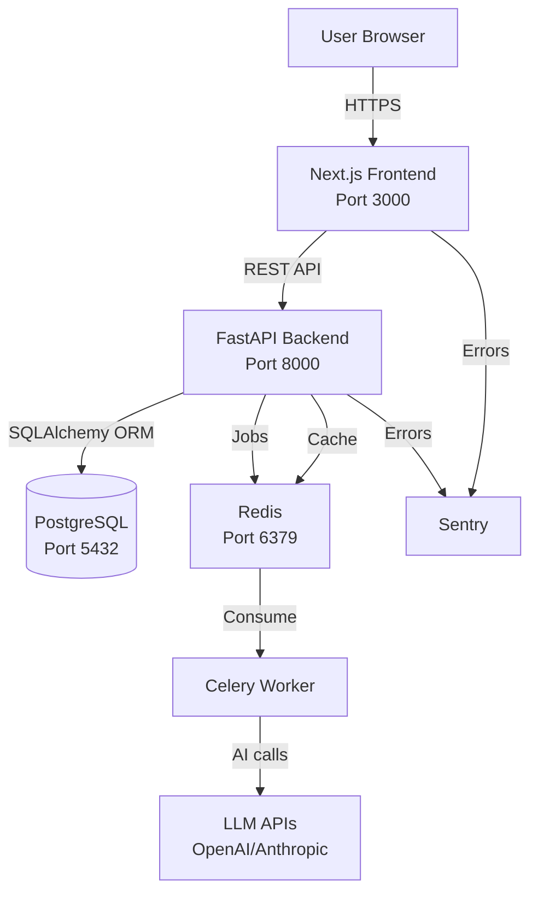

# MailNexa AI — Architecture

## Component Diagram



## Stack
| Layer | Technology | Reason |
|-------|-----------|--------|
| Frontend | Next.js 14 + TypeScript | SSR, App Router, type safety |
| Styling | Tailwind CSS | Utility-first, fast iteration |
| Backend | FastAPI (Python 3.12) | Fast, Pydantic validation built-in |
| ORM | SQLAlchemy + Alembic | Battle-tested, migration support |
| Database | PostgreSQL 16 | Reliable relational DB |
| Cache/Queue | Redis | Fast, supports Celery |
| Background Jobs | Celery | Mature Python job queue |
| Auth | Custom JWT (jose) | Full control, token revocation |
| AI | Heuristic + LLM fallback | Works without API key |
| Error Tracking | Sentry | Industry standard |
| Container | Docker Compose | Simple local + production parity |

## Folder Structure
```
mailnexa-ai/
├── backend/
│   ├── app/
│   │   ├── api/          # Route handlers (thin — no business logic)
│   │   ├── services/     # Business logic (fat — all logic here)
│   │   ├── workers/      # Celery background tasks
│   │   ├── models.py     # SQLAlchemy models
│   │   ├── schemas.py    # Pydantic request/response schemas
│   │   ├── permissions.py # Central can() / require() functions
│   │   ├── middleware.py  # Request ID, security headers
│   │   ├── logging_config.py # Structured JSON logging
│   │   ├── ratelimit.py  # Rate limiting
│   │   ├── security.py   # JWT, password hashing
│   │   ├── config.py     # Settings from env vars
│   │   ├── database.py   # DB connection
│   │   └── main.py       # App entry point
│   ├── alembic/          # DB migrations
│   ├── tests/            # pytest tests
│   ├── datasets/         # Seed data
│   └── requirements.txt
├── frontend/
│   └── src/
│       ├── app/          # Next.js App Router pages
│       ├── components/   # Shared UI components
│       ├── lib/          # API client, utilities
│       └── types/        # TypeScript interfaces
├── docs/
│   ├── system-design.md
│   ├── architecture.md
│   ├── permissions.md
│   ├── decisions/        # ADRs
│   └── runbooks/         # Operational procedures
├── .github/workflows/    # CI/CD
├── docker-compose.yml
├── CLAUDE.md             # Agent memory
└── README.md
```

## Background Jobs
Celery workers consume from Redis queue. Jobs:
- `process_email` — AI analysis pipeline (async after upload)
- `send_notification` — Email/push notifications
- `generate_analytics` — Periodic analytics aggregation

## Riskiest Decisions
1. **SQLite for local dev** — Must use PostgreSQL in production; schema divergence risk
2. **Custom JWT auth** — More control but more responsibility; consider Clerk/Auth.js for v2
3. **Heuristic AI engine** — Fast but less accurate; LLM integration needed for real accuracy
